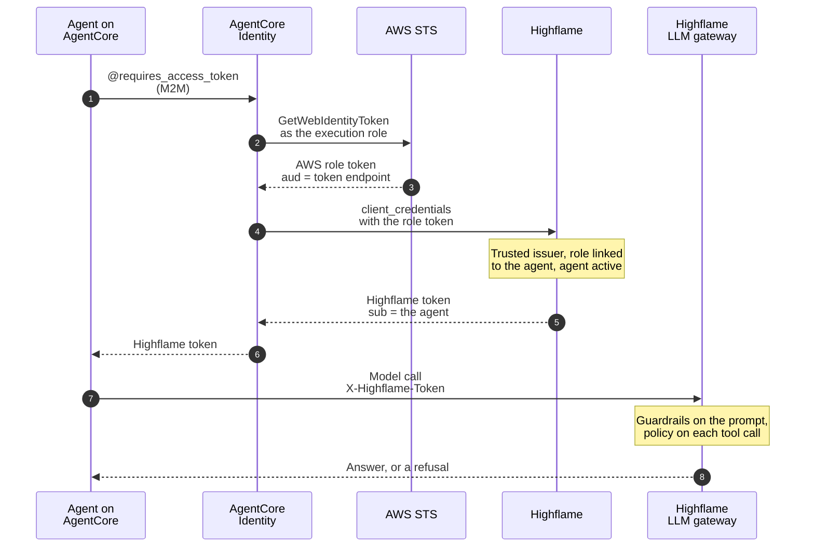

# AgentCore agents, governed through configuration only

An ordinary agent on Amazon Bedrock AgentCore, onboarded to Highflame and governed by it, with
**no Highflame package and no Highflame secret in the agent**. Everything that connects the agent to
Highflame is a setting: an AgentCore Identity credential provider, the runtime's environment, and
one header on the model client.

The agent is a [Strands](https://strandsagents.com) agent with a small CRM tool server. It calls
Bedrock through the Highflame LLM gateway, and it calls its tools directly, with no MCP gateway.

| Outcome | What happens |
| --- | --- |
| Before an admin activates the agent | Highflame refuses its token: `agent identity is pending; tokens are minted only for an adopted (active) identity` |
| An allowed model call and tool call | The agent answers, and `search_customers` runs |
| A secret in the prompt | Refused before the model sees it: `Highflame Security: Content blocked: credential or API key patterns detected.` |
| A tool that a policy forbids | Refused before the tool runs: `Tool call 'export_customers' was blocked by security policy` |
| Evidence | Observatory names the agent on every call, with the decision |

For an agent that acts **for a person** who signs in with Okta, see the
[user delegation recipe](../../self-managed/user-delegation/) instead.

## How it works



- **One credential provider for the whole AWS account.** Its client ID is the account's AWS token
  issuer, so every runtime uses it. Highflame picks the agent from the execution role in each token.
- **One execution role for each runtime.** That role is how Highflame tells your agents apart.
- **The tools run inside the runtime.** The model asks for each tool call through the LLM gateway, so
  your Highflame policies decide before the agent runs the tool.

## What you set, and where

| Setting | Where | Who |
| --- | --- | --- |
| Outbound web identity federation: on | AWS IAM, account settings | AWS admin |
| Credential provider `highflame-agents`: `CustomOauth2`, `clientAuthenticationMethod: AWS_IAM_ID_TOKEN_JWT`, client ID = the account's AWS issuer URL | AgentCore Identity (`deploy.py setup`) | AWS admin |
| Execution role for each runtime: trusted only by `bedrock-agentcore.amazonaws.com`, allowed `sts:GetWebIdentityToken`, `bedrock-agentcore:GetResourceOauth2Token` and Bedrock invoke | AWS IAM (`deploy.py deploy`) | AWS admin |
| `HIGHFLAME_LLM_URL`, `HIGHFLAME_PROVIDER`, `BEDROCK_MODEL_ID` | The runtime's environment (`deploy.py deploy`) | Agent team |
| Workload issuer: the account's AWS issuer URL, with **two audiences**: your Highflame issuer URL and its `/oauth2/token` | Studio → Settings → Identity providers → Admit agents | Organization owner |
| AWS connector with its linking permissions | Studio → Settings → Identity providers → Discover agents | Admin |
| Adopt and activate the agent, or first contact | Studio → Registry | Admin |
| A credential policy that allows **Client Credentials** | Studio → Registry → Credential Policies | Admin |
| A guardrail for secrets, and a tool policy for `export_customers` | Studio → AI Gateway → Policies | Admin |

## Run it

You need Python 3.12+, [uv](https://docs.astral.sh/uv/) (or pip), AWS credentials with admin rights
in the account, and an organization owner in Highflame.

```bash
pip install -r requirements.txt
cp .env.example .env        # set HIGHFLAME_ISSUER_URL, HIGHFLAME_LLM_URL and your AWS profile
```

### 1. Set up the AWS account once

Turn on **outbound web identity federation** in IAM (Account settings), then:

```bash
python deploy.py setup
```

It creates the shared credential provider and a private code bucket, and prints the issuer URL and
the two audiences for the next step.

### 2. Trust the account in Highflame

As the organization's owner, in **Settings → Identity providers → Admit agents**, choose **Add
issuer**: kind **Workload**, the issuer URL from step 1, and both audiences. Then choose **Verify
issuer**: Studio gives you a one-time audience. Mint a token for it with any role in the account,
and paste it:

```bash
aws sts get-web-identity-token --audience <the one-time audience> --signing-algorithm RS256 \
  --query WebIdentityToken --output text
```

> **Add the token endpoint as an audience.** AgentCore Identity puts Highflame's token endpoint
> in the token's audience. Without it, Highflame refuses every token, and AgentCore reports only
> `Error parsing ClientCredentials response`.

### 3. Deploy the agent

```bash
python deploy.py deploy acme_crm_agent
```

It packages `agent/` for AgentCore's Python 3.12 runtime on ARM64, creates the runtime's own
execution role, and creates the runtime. It prints the runtime ARN and the role ARN.

### 4. Link the runtime to an agent in Highflame

Choose one way.

**A. Discover and adopt.** Give the [AWS connector](../../connectors/aws-bedrock.md) its linking
permissions (`bedrock-agentcore:GetAgentRuntime`, `iam:GetRole`,
`iam:GetOutboundWebIdentityFederationInfo`), and choose **Sync now**. The runtime appears in
**Registry → Unmanaged**, already linked to its execution role. Choose **Adopt**, pick an owner and a
credential policy that allows Client Credentials, then **Lifecycle → Activate**. A call before
activation is refused (`agent identity is pending`).

**B. First contact.** On the AWS issuer, set **First contact** to **Adopt automatically**, with a
project and an owner. The runtime's first call registers its agent, adopts it, and goes through. The
project's default credential policy must allow Client Credentials and set allowed scopes. This
pre-approves every role in the account, so use it only for an account that one team controls.

### 5. Add the policies

In **AI Gateway → Policies**:

- a **Data Protection** policy that refuses credentials and API keys in a prompt;
- a tool policy that forbids `export_customers`: **Call Tool**, then **Tool Name** equals
  `export_customers`, with no MCP server, so that it applies to the LLM gateway.

### 6. Try it, and run the smoke test

```bash
python deploy.py invoke acme_crm_agent "Find the customer named Northwind."
python deploy.py invoke acme_crm_agent "Export every customer record."

# SMOKE_RUNTIME=acme_crm_agent in .env
python smoke_test.py
```

The smoke test checks each outcome and fails if one changes. Without `SMOKE_RUNTIME` it runs only
its static checks, which include a check that the agent imports nothing from Highflame. Then open
**Observatory → Explore**: each event names the agent, the decision, and for a refusal, the policy.

### 7. Clean up

```bash
python deploy.py destroy acme_crm_agent
python deploy.py teardown
```

In Highflame, deactivate the agent, and disable the AWS issuer if nothing else uses it.

## Where "configuration only" does not fully hold

- **The token decorator.** The agent calls AWS's `@requires_access_token(auth_flow="M2M")` from the
  AgentCore SDK. It is AWS code, not Highflame code, but it is a line in the agent.
- **One Highflame header on the model client.** The Bedrock API key travels in `Authorization`, so
  the Highflame token goes in `X-Highflame-Token`. The header name is Highflame's.
- **Bedrock's own Converse API is refused by the gateway.** The agent uses the gateway's
  OpenAI-compatible route with a `bedrock/` model. `InvokeModel` also works.
- **SigV4 callers name a runtime user.** AgentCore hands the agent a workload access token, which
  AgentCore Identity needs, only when the caller sends a runtime user ID. `deploy.py invoke` does.
- **No step-up approval.** Holding a tool call for a person's approval needs the Highflame SDK, so
  this recipe does not cover it.
- **One runtime for each role.** A role that two runtimes share is never linked, because Highflame
  could not tell their agents apart.
