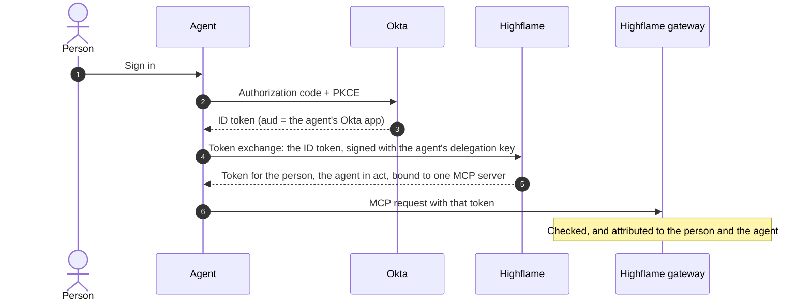
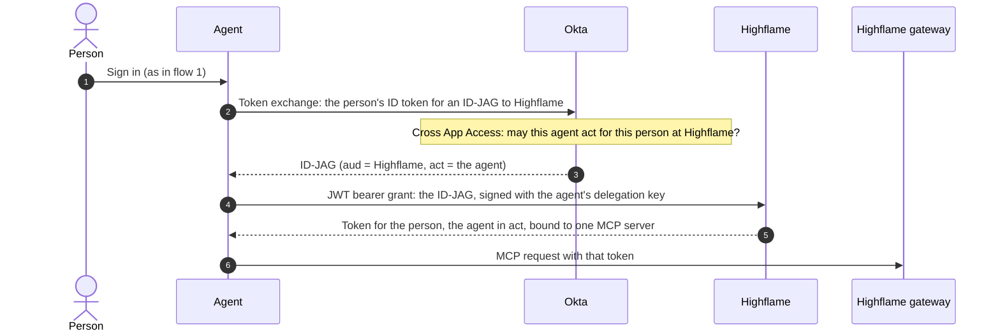

# User delegation · an agent acts for a signed-in person, with Okta

**The value:** *"Our agents act for our people. When an agent reads a page or files a
ticket, we need to know which person it acted for, and limit what it may do for them.
We want this with the Okta sign-in our agents already have, not a new one."*

A person signs in to the agent with Okta. The agent trades that sign-in for a Highflame
token **issued for the person, with the agent named in it**. Every call the agent makes
through the Highflame gateway is then attributed to both, and limited by the agent's
credential policy.

Highflame accepts the tokens Okta already issues. The agent keeps its Okta app, its
client authentication, and its sign-in. It adds one token request to Highflame.

There are two flows. Use the one that fits how your organization governs agents:

| | Flow 1: ID token | Flow 2: ID-JAG |
|---|---|---|
| The agent sends Highflame | the person's ID token | an ID-JAG that Okta issues to the agent |
| Who decides that the agent may act for the person | Highflame | Okta first (Cross App Access), then Highflame |
| Standard | OAuth 2.0 Token Exchange ([RFC 8693](https://www.rfc-editor.org/rfc/rfc8693)) | [Identity Assertion JWT Authorization Grant](https://datatracker.ietf.org/doc/draft-ietf-oauth-identity-assertion-authz-grant/), redeemed with the JWT bearer grant ([RFC 7523](https://www.rfc-editor.org/rfc/rfc7523)) |
| Okta setup | the agent's OIDC app | the agent's OIDC app, registered as an AI agent, with a connection to Highflame |
| Script | [`id_token_flow.py`](id_token_flow.py) | [`id_jag_flow.py`](id_jag_flow.py) |

In both flows the agent signs its request to Highflame with its own **delegation key**.
Highflame issues no client secret.

### The full example: a Strands agent on Amazon Bedrock AgentCore

[`strands_agentcore_id_token.ipynb`](strands_agentcore_id_token.ipynb) builds on flow 1. Its agent,
[`agent_app.py`](agent_app.py), is a Strands agent packaged as an AgentCore app. AgentCore
validates the person's Okta ID token and passes it to the agent. The agent exchanges it for one
Highflame token per gateway, and sends all its traffic through Highflame:

- **the model calls** through the Highflame LLM gateway, which records each call and checks every
  tool call the model makes, before the agent runs it;
- **the tool calls** through the Highflame MCP gateway, which calls each MCP server with the
  person's own connection.

The notebook runs the agent on your machine first, then shows the commands that deploy it to
AgentCore, and one gateway policy that blocks a tool on both paths. It also needs
AWS Bedrock turned on under Studio → **AI Gateway** → **LLM Providers** (it is on by default), and
AWS credentials that may call the model.

### Without the MCP gateway: tool calls governed at the LLM gateway

[`strands_direct_mcp_llm_gateway.ipynb`](strands_direct_mcp_llm_gateway.ipynb) is for an agent that
calls its MCP servers directly, and sends only its model calls through Highflame. The MCP server
does not need to be registered in Highflame. The LLM gateway sees each tool call the model asks
for: it records the call for the person and the agent, and a gateway policy can refuse it before
the agent runs it. The notebook uses a small example MCP server,
[`example_mcp_server.py`](example_mcp_server.py), that runs on your machine.

### Flow 1: the ID token



### Flow 2: the ID-JAG



---

## What you need

- **A customer-managed Highflame deployment with domain join.** Highflame links a person
  by a verified email on one of your organization's claimed domains. Your Highflame
  administrator claims the domain. Highflame's hosted service does not offer person
  federation yet.
- **The person is a member of your Highflame organization**, with the same email address
  as in Okta.
- **An Okta org.** For flow 2, the org needs Cross App Access (Okta for AI Agents).
- **An MCP server registered at your Highflame MCP gateway.**
- Python 3.10 or later.

---

## Set it up in Highflame

Do these steps once, in Highflame Studio.

1. **Trust your Okta org.** The organization owner does this step. Go to Studio →
   Registry → Integrations → Identity Providers → **Admit agents** → **Add issuer**.
   - Identity provider: **Okta**. Okta org URL: `https://acme.okta.com`. Kind:
     **Person**.
   - Turn on **Trust this directory's email addresses**. Okta returns `email_verified`
     only from its UserInfo endpoint, so the ID tokens and ID-JAGs your agent gets carry
     the email without it. With this setting on, Highflame links the person by that email
     the first time, on one of your claimed domains. A token that says the email is
     unverified is still refused.
2. **Verify the issuer.** The organization owner does this step. On the issuer, choose
   **Verify**, and sign in as yourself. **Setup checklists** → **Okta (ID-JAG)** shows the
   small Okta app that this test sign-in needs. Agents cannot act for people through the
   issuer until it is verified.
3. **Give the agent a credential policy.** Go to Registry → Authorization → **Credential
   Policies** → Create Policy.
   - Under **Allowed grant types**, turn on **Token Exchange** for flow 1, and **JWT Bearer**
     for flow 2. A new policy allows only **API Key** and **Client Credentials**.
   - List the scopes the agent may get for a person, for example `tools:read`.

   Then register the agent with that policy: Registry → Agents → **Inventory** → Register
   Identity.
4. **Add the agent's delegation key.** Make an EC P-256 key pair:

   ```bash
   openssl ecparam -name prime256v1 -genkey -noout -out agent.key.pem
   openssl ec -in agent.key.pem -pubout -out agent.pub.pem
   ```

   On the agent, open **Credentials** → **Delegation key** → **Add key**, and paste
   `agent.pub.pem`. Keep `agent.key.pem` with the agent. It signs the agent's requests to
   Highflame.
5. **Link the agent to its Okta app.** On the agent, open **Credentials** → **IdP sign-in
   links** → **Link to IdP app**.
   - Trusted issuer: your Okta org.
   - Okta OAuth client id: the client id of the agent's app in Okta.
   - Turn on **Create the agent's OAuth client**.

---

## Set it up in Okta

### The agent's app (both flows)

If your agent already has an OIDC app in Okta, use it, and do only steps 3 and 5.

1. Go to Applications → Applications → **Create App Integration** → **OIDC - OpenID
   Connect** → **Web Application**.
2. Grant types: **Authorization Code** and **Refresh Token**. Do not add **Implicit**: Okta
   does not let an app with the implicit grant act as an AI agent.
3. Sign-in redirect URIs: add `http://localhost:8765/callback`, for `signin.py`.
4. Client authentication: use what your agent uses. The scripts accept a client secret or
   a public key / private key.
5. Assignments: assign the person.

### The connection to Highflame (flow 2 only)

Okta issues an ID-JAG for an app integration that has Cross App Access and stands for
Highflame. To try this flow, build that integration with the OIN Wizard in an Okta
Integrator Free Plan org:

1. **Create the Highflame integration.** In the OIN Wizard, choose OIDC and **Cross App
   Access**, with the role **Resource app**. Set its **Issuer URL** to Highflame's issuer.
   Studio shows that value in **Setup checklists** → **Okta (ID-JAG)**, step 4. Add the
   scopes your agents ask for, for example `tools:read`.
2. **Make an instance.** The wizard's test page needs the Okta Browser Plugin. Choose
   **Generate Instance**, and assign the person to the instance.
3. **Let agents call it.** On the instance, open **Machine Assignments** → **Callers** →
   **Cross-app access (XAA)** → **Edit**, and set it to **Enabled**.
4. **Register the agent.** Go to Directory → **AI Agents**. Register the agent manually,
   choose the agent's existing app, and set an owner.
5. **Connect the agent to Highflame.** On the AI agent, open **Resource connections**, and
   add a connection to an application of the type **App configured for AI Agent access**.
   Choose the Highflame instance. For the client ID registered in Highflame, enter the
   agent's Okta client id: the value you linked in Highflame step 5. Allow the scopes the
   agent asks for.

---

## Run it

```bash
pip install -r requirements.txt
cp .env.example .env      # then fill it in
python signin.py          # once: sign in as the person in your browser
python id_token_flow.py   # flow 1
python id_jag_flow.py     # flow 2
```

`signin.py` stands in for your agent's own sign-in. It saves the person's ID token and
refresh token to `.tokens/`, readable by you only. The scripts print token claims, never
tokens.

Highflame accepts an ID token for 10 minutes after Okta issues it, unless your trusted
issuer sets another limit. Before they use a saved ID token that is more than 5 minutes
old, the scripts get a new one with the refresh token. That is a standard OAuth refresh,
with no new sign-in.

For flow 2, Okta also accepts the person's refresh token as the subject token. That lets a
long-running agent get a new ID-JAG without a new ID token:
`python id_jag_flow.py --from-refresh-token`.

### What you see

Flow 2, with the example values of this README:

```text
1. The ID-JAG, from Okta
  iss              https://acme.okta.com
  aud              https://auth.highflame.example.com
  sub              00u1a2b3c4d5e6f7g8h9
  email            jane@acme.com
  client_id        0oa1b2c3d4e5f6g7h8i9
  act.sub          0oa1b2c3d4e5f6g7h8i9
  scope            tools:read
  resource         <absent>

2. The Highflame token: for the person, with the agent in act
  sub              user_2Nf8xKq3WbLm9TzYpQr7sVd1HcE
  principal_type   user
  act.sub          spiffe://highflame.example/acct/proj/agent/support-agent
  aud              ['https://gateway.highflame.example.com/mcp/notion']
  scope            tools:read
  user_idp_iss     https://acme.okta.com
  user_idp_sub     00u1a2b3c4d5e6f7g8h9

3. tools/list through the Highflame gateway: 43 tools ['notion-search', 'notion-fetch', ...]
```

- `sub` is the person's Highflame user, not the agent. `act.sub` is the agent.
- `aud` binds the token to the one MCP server the agent asked for. It does not work on
  another server.
- `scope` is what the person may let this agent do: the scopes the agent asked for, inside
  its credential policy.
- The ID token and the ID-JAG have no `email_verified` claim. That is why step 1 turns on
  **Trust this directory's email addresses**.

Run `python smoke_test.py` to run both flows again with the saved sign-in.

---

## Troubleshooting

| What you see | Why | What to do |
|---|---|---|
| `invalid_grant: the person is not a member of this organization` | Highflame did not find exactly one member with this email on a claimed domain, or the email is not trusted. | Make sure the person is a member with the same email as in Okta, and that the domain is claimed. Turn on **Trust this directory's email addresses** on the issuer. |
| `policy_violation: … grant type "token_exchange" is not permitted` (or `"jwt_bearer"`) | The agent's credential policy does not allow the flow's grant type. | On the credential policy, turn on **Token Exchange** (flow 1) or **JWT Bearer** (flow 2). |
| `policy_violation` about a scope | The agent asked for a scope that its credential policy does not allow. | Add the scope to the credential policy, or ask for less with `SCOPE`. |
| `invalid_client` from Highflame | The request is not signed with the key on the agent, or the agent has no OAuth client for this Okta app. | Check `AGENT_PRIVATE_KEY_PATH` against the agent's **Delegation key**. Check the **IdP sign-in link**, with **Create the agent's OAuth client** on. |
| `the ID-JAG has no resource claim and the request names no resource` | The agent did not name the MCP server. | Set `MCP_SERVER_URL`. |
| Okta: `invalid_target` | The agent sent `resource` to Okta, and the Okta connection has no resource indicator. | Do not send `resource` to Okta. Name the MCP server at Highflame, as `id_jag_flow.py` does. |
| Okta refuses the ID-JAG request | The agent is not an AI agent with a connection to the Highflame instance, or callers cannot use Cross App Access. | Do the steps in [The connection to Highflame](#the-connection-to-highflame-flow-2-only) again. |
| Highflame refuses an ID-JAG that has a `resource` claim | The Okta connection sets a resource indicator that is not `MCP_SERVER_URL`. | Set the resource indicator to `MCP_SERVER_URL`, or remove it. |
| The MCP server answers `401` | The token is bound to another URL. | Use the same URL for `MCP_SERVER_URL` and for the MCP calls. |
